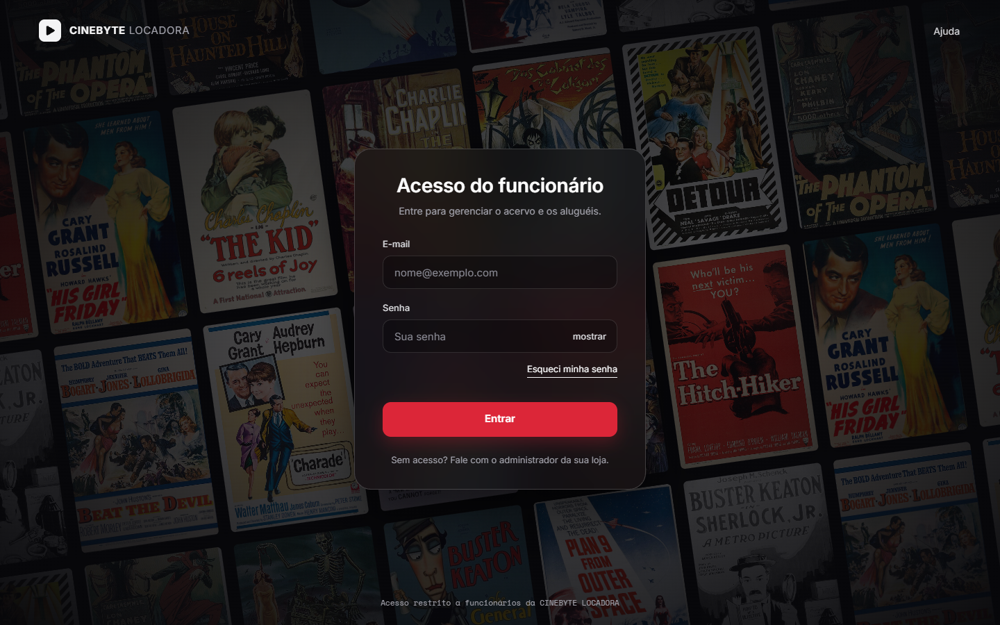
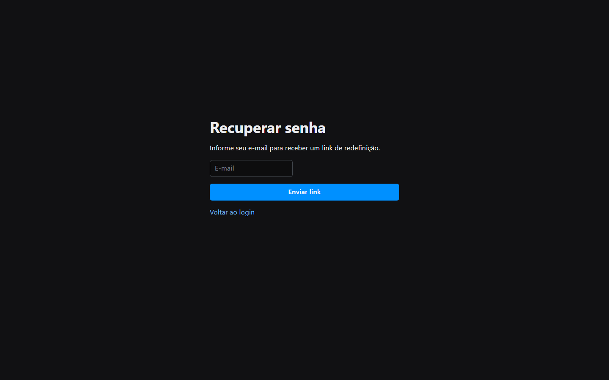
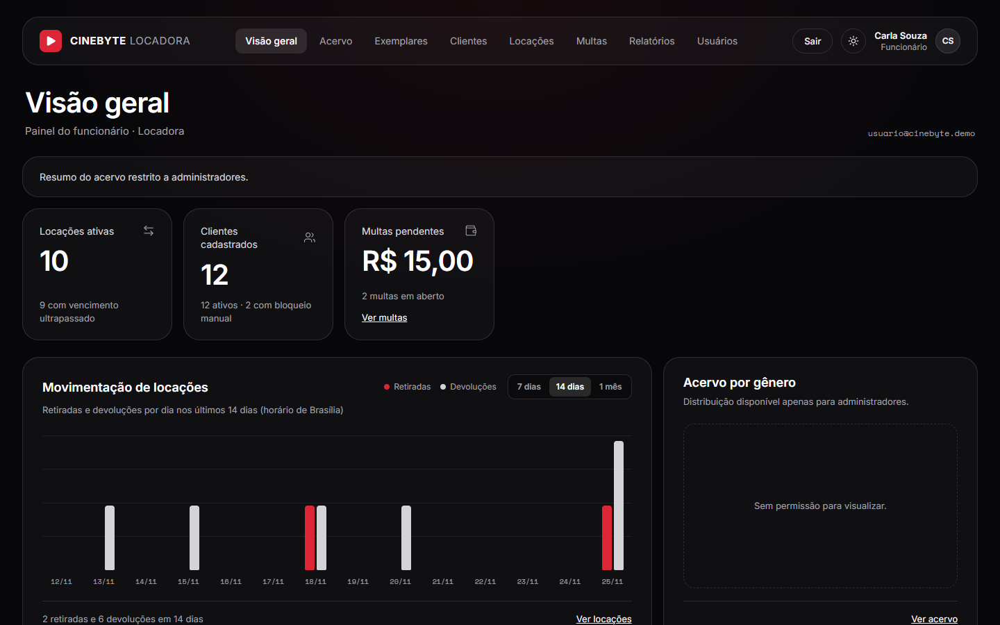
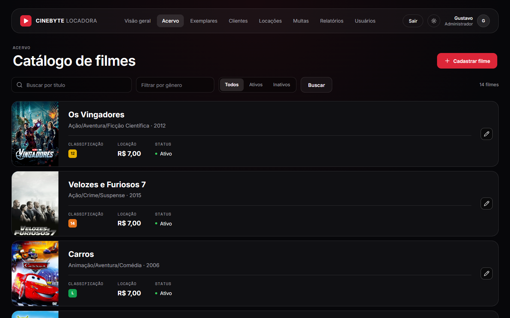
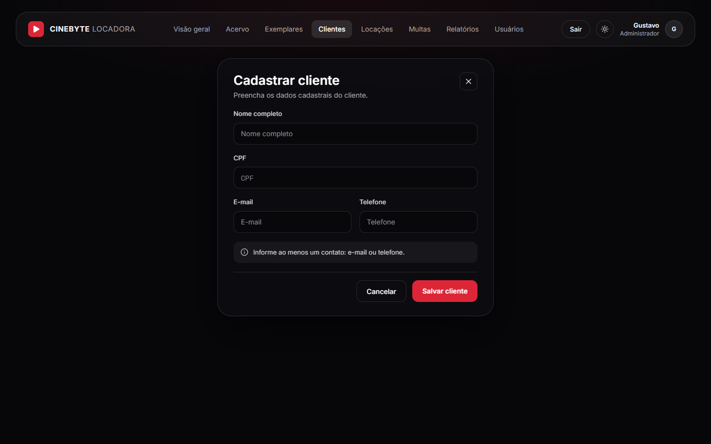
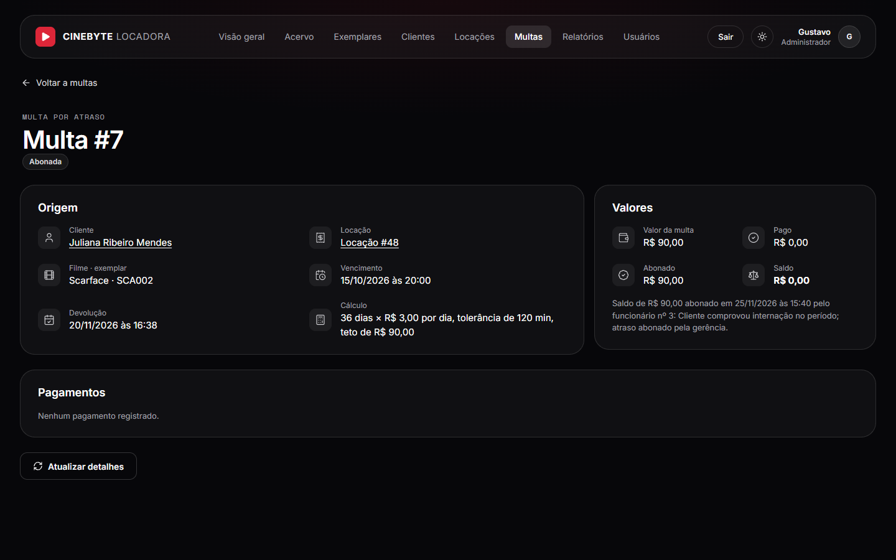
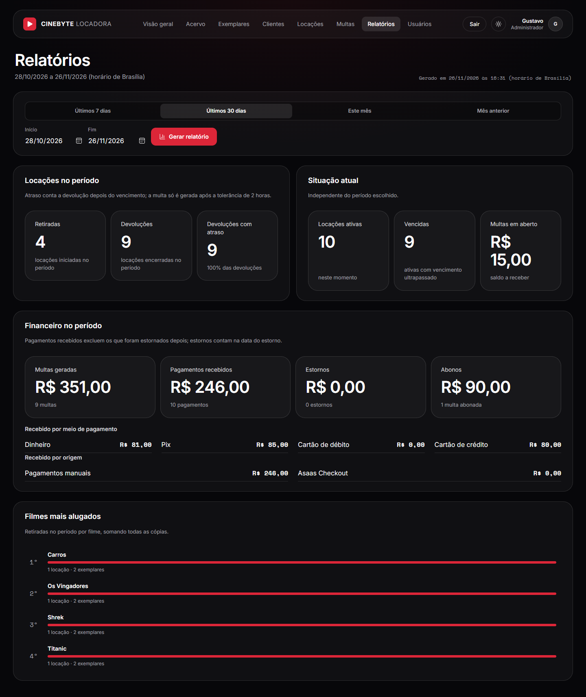
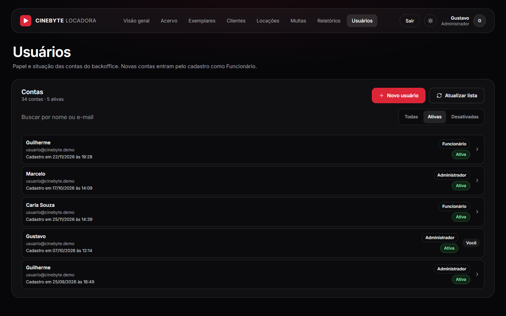

# CINEBYTE LOCADORA

Manual de uso do aplicativo web de gestão interna de uma locadora de filmes.

> 🎬 **Vídeo de demonstração:** [assista no YouTube](https://youtu.be/0W-0zOHIJdQ) (cerca de 5 minutos, mostrando as jornadas do funcionário e do administrador).



## Sumário

1. [Apresentação](#1-apresentação)
2. [Acesso ao aplicativo](#2-acesso-ao-aplicativo)
3. [Perfis de usuários](#3-perfis-de-usuários)
4. [Funcionalidades](#4-funcionalidades)
5. [Manual de utilização](#5-manual-de-utilização)
6. [Exemplos de utilização](#6-exemplos-de-utilização)
7. [Limitações conhecidas](#7-limitações-conhecidas)
8. [Estrutura técnica](#8-estrutura-técnica)

---

## 1. Apresentação

O **CINEBYTE LOCADORA** é um aplicativo web interno, de uso exclusivo da equipe da loja. Ele reúne em um só lugar o acervo de filmes, as cópias físicas (exemplares), os clientes, as locações, as devoluções, as multas por atraso, os pagamentos e os relatórios.

### Problema que resolve

Sem um sistema, a equipe controla catálogo, cópias, prazos, multas e pagamentos em planilhas e anotações. Isso abre espaço para vários erros:

- alugar uma cópia que já está com outro cliente;
- alugar para um cliente bloqueado ou com multas em aberto;
- esquecer atrasos e calcular multas de forma inconsistente;
- perder o histórico de pagamentos, estornos e abonos.

O CINEBYTE aplica essas regras automaticamente e mantém o histórico de todas as operações. Nada é apagado: estornos e abonos ficam registrados com motivo e responsável.

### Público-alvo

Funcionários e administradores de uma locadora de filmes. O sistema não tem área para o cliente final.

---

## 2. Acesso ao aplicativo

- **Deploy público:** não há URL pública nesta versão. O aplicativo roda localmente.
- **Endereço local:** `http://localhost:3000/login`
- **Contas:** o acesso exige uma conta interna ativa, criada por um administrador na tela **Usuários**. Não há cadastro aberto ao público.

### Primeiro acesso e recuperação de senha

As contas são criadas **sem senha**. Para definir a senha no primeiro acesso, ou para trocar uma senha esquecida:

1. Na tela de entrada, selecione **Esqueci minha senha**.
2. Informe o e-mail da conta e selecione **Enviar link**.
3. Abra o link recebido por e-mail e defina a nova senha.

**Resultado esperado:** a tela confirma o envio, e o link leva à página `/redefinir-senha`. Cada link vale para um só uso e expira.



### Como executar localmente

Pré-requisitos: Python 3.14, Windows com PowerShell e as variáveis do Xano configuradas no arquivo `.env`.

```powershell
py -3.14 -m venv .venv
.\.venv\Scripts\Activate.ps1
python -m pip install -r requirements.txt
.\.venv\Scripts\reflex.exe run --env prod --single-port
```

Em seguida, abra `http://localhost:3000/login`.

Para verificar o projeto antes de uma entrega:

```powershell
.\.venv\Scripts\reflex.exe compile --dry
.\.venv\Scripts\python.exe -m unittest discover -v
```

As credenciais e os valores reais das variáveis ficam apenas no `.env` local e não vão para o GitHub.

---

## 3. Perfis de usuários

| Ação | Funcionário (`member`) | Administrador (`admin`) |
|---|:---:|:---:|
| Entrar, trocar o tema, recuperar a senha | ✅ | ✅ |
| Ver a visão geral (painel) | ✅ parcial¹ | ✅ completa |
| Consultar filmes, exemplares e clientes | ✅ | ✅ |
| Registrar locação e devolução | ✅ | ✅ |
| Registrar pagamento de multa | ✅ | ✅ |
| Cadastrar e editar filmes, capas e exemplares | — | ✅ |
| Dar baixa e reativar exemplares | — | ✅ |
| Cadastrar e editar clientes | — | ✅ |
| Aplicar ou remover bloqueio manual de cliente | — | ✅ |
| Estornar pagamento e abonar saldo de multa | — | ✅ |
| Ver relatórios | — | ✅ |
| Criar contas e alterar papel ou situação de outras contas | — | ✅ |

¹ O funcionário vê locações ativas, clientes, multas pendentes e a movimentação recente. O resumo do acervo é restrito ao administrador.

- **Funcionário:** atende o balcão. Registra as retiradas e as devoluções e recebe as multas.
- **Administrador:** cuida do catálogo, dos cadastros, dos ajustes financeiros, dos relatórios e das contas da equipe.

As permissões valem na interface e também no backend: a função `enforce_role` no Xano recusa operações de quem não tem o papel exigido.

---

## 4. Funcionalidades

- **Autenticação:** login, saída e recuperação de senha por e-mail.
- **Visão geral:** indicadores, movimentação de locações por período, locações vencidas e clientes que mais alugam.
- **Acervo (filmes):** cadastro, edição, capa por link, ativação e inativação, busca por título ou gênero e filtro de status.
- **Exemplares:** cópias físicas de cada filme, com cadastro, edição, baixa e reativação, busca por identificador e filtro por filme.
- **Clientes:** cadastro com validação de CPF, edição, busca por nome ou CPF e ficha com locações, multas e pagamentos. Inclui o bloqueio manual.
- **Locações:** registro em três etapas (cliente, exemplar, vencimento), lista de ativas e devolvidas, e consulta pelo número.
- **Devoluções:** encerram a locação, liberam a cópia e geram a multa automaticamente quando há atraso.
- **Multas:** abas Em aberto, Quitadas, Abonadas e Todas. Pagamento manual (dinheiro, Pix, débito, crédito), estorno e abono.
- **Relatórios:** locações, atrasos, financeiro por forma de pagamento e filmes mais alugados, por período.
- **Usuários:** criação de contas e alteração de papel e situação, com motivo registrado.
- **Tema claro e escuro:** a escolha fica guardada no navegador.

### Regras de negócio principais

- Só aparecem para locação as cópias **disponíveis**. Uma cópia alugada fica indisponível até a devolução.
- Clientes **inativos**, **bloqueados** ou **com multas em aberto** não podem iniciar uma locação.
- **Multa por atraso:** R$ 3,00 por dia, depois de 2 horas de tolerância, limitada a 30 diárias (R$ 90,00).
- O pagamento manual não pode passar do saldo devido.
- Estornos e abonos exigem motivo e ficam no histórico.

---

## 5. Manual de utilização

O manual segue a ordem de uso: primeiro a jornada do **funcionário** no balcão, depois a do **administrador** e, por fim, as funções complementares.

### 5.1 Jornada do funcionário

#### Passo 1: Entrar no sistema

1. Acesse `http://localhost:3000/login`.
2. Informe o e-mail e a senha e selecione **Entrar**.

**Resultado esperado:** abre a **Visão geral**. No canto superior direito aparecem o nome e o perfil (**Funcionário**).



#### Passo 2: Registrar uma locação

1. Selecione **Locações** na barra superior.
2. **Etapa 1, Cliente:** busque pelo nome e selecione o cliente. Clientes bloqueados aparecem marcados e não podem ser escolhidos.
3. **Etapa 2, Exemplar:** selecione a cópia física. Só aparecem cópias disponíveis.
4. **Etapa 3, Vencimento:** informe a data e a hora de devolução (horário de Brasília) e confira o resumo.
5. Selecione **Confirmar locação**.

Enquanto faltar alguma informação, o quadro **"Para confirmar, falta:"** lista o que precisa ser preenchido.

**Resultado esperado:** aparece "Locação registrada" com o número da locação. A cópia sai da lista de disponíveis e a locação entra em **Ativas**, na lista ao lado.


#### Passo 3: Consultar uma locação e registrar a devolução

1. Em **Locações**, digite o número no campo **Abrir locação pelo número** e selecione **Abrir**. Outra opção é abrir a locação pela lista.
2. Confira cliente, exemplar, retirada e vencimento. Locações atrasadas aparecem como **Vencimento ultrapassado**.
3. Selecione **Registrar devolução** e depois **Confirmar devolução**. Antes de confirmar, o sistema mostra a estimativa da multa.

**Resultado esperado:** a locação passa para **Devolvida** e a cópia volta a ficar disponível. Se houve atraso, aparece a mensagem com o valor e o número da multa gerada (por exemplo, "Multa por atraso gerada: R$ 45,00 (15 dias), multa nº 9").


#### Passo 4: Receber o pagamento da multa

1. Selecione **Multas** e a aba **Em aberto**.
2. Abra a multa do cliente.
3. Em **Registrar pagamento**, confira o valor (por padrão, o saldo) e escolha o meio: dinheiro, Pix, cartão de débito ou cartão de crédito.
4. Selecione **Registrar pagamento** e depois **Confirmar pagamento**.

**Resultado esperado:** aparece a mensagem "Pagamento de R$ … registrado. Multa quitada.", o saldo fica em R$ 0,00 e a multa passa para a aba **Quitadas**. O pagamento entra no histórico da multa com a data, o meio e o funcionário que o registrou.


#### O que o funcionário não acessa

Ao abrir **Relatórios**, o funcionário vê o aviso "Relatórios disponíveis apenas para administradores". As ações de cadastro, edição, estorno, abono e gestão de usuários também ficam restritas ao administrador.


### 5.2 Jornada do administrador

#### Passo 1: Cadastrar um filme e a capa

1. Selecione **Acervo** e depois **Cadastrar filme**.
2. Informe título, gênero, ano de lançamento, classificação indicativa e valor da locação, e selecione **Salvar alterações**.
3. Para colocar a capa, selecione o ícone de lápis (**Editar**) no cartão do filme.
4. Cole no campo de link o endereço **https** da imagem e selecione **Usar link**.

**Resultado esperado:** o filme aparece no catálogo como **Ativo**. Depois de "Link da capa salvo.", a capa passa a ser exibida no Acervo e em Exemplares.




#### Passo 2: Cadastrar um exemplar

O filme é o título do catálogo. Para alugá-lo, é preciso ter ao menos uma cópia física.

1. Selecione **Exemplares** e depois **Cadastrar exemplar**. Outra opção é **Adicionar cópia**, direto no cartão do filme.
2. Informe um identificador único (por exemplo, `VAL981`) e selecione o filme.
3. Selecione **Cadastrar exemplar**.

**Resultado esperado:** a cópia aparece no cartão do filme e passa a estar disponível na etapa 2 da locação.


#### Passo 3: Cadastrar um cliente

1. Selecione **Clientes** e depois **Cadastrar cliente**.
2. Informe o nome completo, o CPF e ao menos um contato (e-mail ou telefone).
3. Selecione **Salvar cliente**.

**Resultado esperado:** aparece "Cliente cadastrado com sucesso." e o cliente entra na lista. O sistema recusa CPF inválido ou já cadastrado.




#### Passo 4: Bloquear um cliente

1. Em **Clientes**, selecione **Consultar** na linha do cliente.
2. Na ficha, veja dados, locações, multas, pagamentos e saldo em aberto.
3. Em **Controle de bloqueio manual**, informe o motivo e selecione **Aplicar bloqueio manual**.

**Resultado esperado:** o cliente aparece como **Bloqueado** na lista e na etapa 1 da locação, e não pode iniciar novas locações até o bloqueio ser removido.

#### Passo 5: Estornar um pagamento ou abonar uma multa

- **Abonar saldo:** abra a multa em aberto, selecione **Abonar saldo**, informe o motivo e selecione **Confirmar**. A multa passa para **Abonadas**.
- **Estornar pagamento:** abra a multa, selecione **Estornar** no pagamento confirmado, informe o motivo e confirme. O saldo volta a ficar em aberto.

**Resultado esperado:** o valor fica registrado como abonado ou estornado, com motivo e responsável. O registro original não é apagado.



#### Passo 6: Consultar relatórios

1. Selecione **Relatórios**.
2. Escolha um período rápido (**Últimos 7 dias**, **Últimos 30 dias**, **Este mês**, **Mês anterior**) ou informe as datas de início e fim e selecione **Gerar relatório**.

**Resultado esperado:** o relatório mostra:

- retiradas, devoluções e devoluções com atraso no período;
- a situação atual: locações ativas, vencidas e multas em aberto;
- o financeiro: multas geradas, pagamentos recebidos, estornos e abonos;
- os valores recebidos por meio de pagamento e por origem;
- o ranking dos filmes mais alugados.



### 5.3 Funcionalidades complementares

- **Busca e filtros:**
  - **Acervo:** busca por título ou gênero e filtro **Todos / Ativos / Inativos**.
  - **Exemplares:** busca por identificador, filtro por filme e **Mostrar baixados**.
  - **Clientes:** busca por nome ou CPF completo.
  - **Multas:** abas por situação.
- **Edição e inativação:**
  - Filmes e clientes podem ser editados e inativados. Inativar não apaga o registro.
  - No menu de ações de um exemplar (**⋯**), o administrador edita, dá baixa (cópia danificada ou perdida) ou reativa a cópia.
- **Gestão de usuários** (administrador):
  - Em **Usuários**, **Novo usuário** cria uma conta ativa e sem senha, com papel Funcionário ou Administrador.
  - O botão de cada conta permite mudar o papel ou a situação (ativa ou desativada), informando um motivo.
  - Ninguém pode alterar a própria conta.

  
- **Tema claro e escuro:** o botão entre **Sair** e o nome do usuário alterna o tema.
- **Situações alternativas:**
  - **Limite de requisições do Xano:** a tela pede para aguardar 20 s; depois, selecione **Tentar novamente**.
  - **Pendências na locação:** a locação não é confirmada e a tela lista o que falta.
  - **Pagamento acima do saldo:** o valor é recusado.

---

## 6. Exemplos de utilização

Os exemplos abaixo usam os dados de demonstração cadastrados na base e mostrados no vídeo.

| Cenário | Entrada | Resultado |
|---|---|---|
| Nova locação (funcionário) | Cliente **Beatriz Rodrigues Alves**, exemplar **TIT002** (Titanic), vencimento 28/11/2026 18:00 | Locação registrada; TIT002 fica indisponível |
| Devolução atrasada (funcionário) | Locação **#8** (Lucas Henrique Silva, *Creed*, venceu em 10/11/2026) | Devolvida em 25/11/2026; multa nº 9 de **R$ 45,00** (15 dias × R$ 3,00) |
| Pagamento de multa (funcionário) | Multa nº 9, R$ 45,00, **Pix** | Saldo R$ 0,00; multa **Quitada** |
| Novo filme (administrador) | **O Garoto** (Comédia/Drama, 1921, Livre, R$ 5,00) e capa por link do Wikimedia Commons (domínio público) | Filme ativo no Acervo, com capa |
| Nova cópia (administrador) | Exemplar **VAL981** de *O Garoto* | Cópia disponível para locação |
| Novo cliente (administrador) | **Rodrigo Alves Pinto**, CPF válido de teste, e-mail `@example.com` | Cliente ativo; depois, **Bloqueado** com motivo "Documento de identidade pendente de conferência." |
| Abono (administrador) | Multa nº 7 (Juliana Ribeiro Mendes, R$ 90,00, 36 dias, no teto de 30 diárias) | Saldo abonado com motivo; multa em **Abonadas** |

Todos os nomes, CPFs e e-mails de clientes são **fictícios**.

---

## 7. Limitações conhecidas

### Publicação

- **Sem deploy público:** o uso documentado é local, em `http://localhost:3000`.
- **Estado em memória:** o Reflex roda como uma única instância, com o estado guardado em memória. Reiniciar o processo encerra as sessões.
- **Escala:** rodar várias instâncias exige configurar o gerenciamento de estado do Reflex.

### Pagamento por cartão (Asaas)

A cobrança por cartão no Checkout do Asaas foi implementada, mas **não está homologada**. A confirmação depende de um webhook, que exige uma URL pública. Ainda não foram feitos:

- uma cobrança de teste com o evento `PAID`;
- a reconciliação de casos ambíguos;
- o cancelamento;
- a operação com a chave de produção.

Até isso acontecer, use apenas o **pagamento manual**.

### Plano atual do Xano

- **Limite de requisições:** 10 a cada 20 segundos. Em uso intenso aparece o aviso de limite, e é preciso aguardar.
- **Capas só por link:** o plano não permite armazenar arquivos, então o envio da imagem pelo computador ("Enviar capa") é recusado. A capa deve ser informada por um link https.
- **"Remover capa" não persiste:** a mensagem "Capa removida." aparece, mas o link antigo volta ao recarregar a página. Para trocar uma capa, informe um novo link.

### Outras restrições

- Contas novas não recebem senha padrão. O e-mail de definição de senha depende da configuração de envio do Xano.
- Não existe exclusão permanente de usuários, clientes, filmes ou exemplares; o sistema usa inativação, baixa e desativação.
- Locação e devolução dependem da variável `XANO_RENTAL_WRITES_ENABLED` habilitada no `.env`.
- Relatórios e o resumo do acervo na visão geral exigem o perfil de administrador.

---

## 8. Estrutura técnica

- **Frontend:** [Reflex](https://reflex.dev) (Python), em `ProjetoLocadora/`.
- **Backend:** Xano (APIs e XanoScript em `xano/`).
- **Especificações:** OpenSpec, em `openspec/`.
- **Testes:** `tests/`.
- **Capturas deste manual:** `docs/screenshots/`.

### Suporte

Em caso de falha de autenticação, limite de requisições ou indisponibilidade do Xano:

1. Confirme que a conta está ativa.
2. Atualize a página.
3. Saia e entre novamente.
4. Aguarde o prazo informado pela tela antes de tentar de novo.
5. Verifique as URLs e as credenciais do `.env` local.
